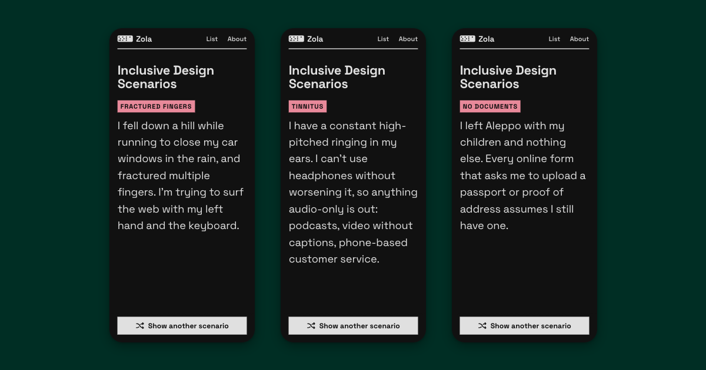

# Zola

Build more accessible products. Each card describes a real person's experience and needs, which your design should accommodate. [Read more about it here](https://www.jackbush.github.io/zola/about/).



## Contributing

This project needs diversity of experience and everybody is welcome. Use the [Issue Tracker](https://github.com/jackbush/zola/issues) to see what needs done, or to find a place to pitch in.

### Writing scenarios

Only submit a scenario if it comes from real experience — your own, someone you know, or primary research. That said, scenarios are standardised to the first person.

- **Human, not clinical.** Use common names for conditions. When a clinical term is necessary, explain it immediately rather than assuming familiarity.
- **Situation first, consequence second.** What is happening to this person, then how it affects their use of technology. The consequence can be implied.
- **No generalisations.** Concrete detail is vital, it lets the user visualise the situation.
- **No pity or inspiration narratives.** State conditions and coping strategies neutrally. Don't moralise.
- **No longer than necessary.** We want these to be memorable, so length should follow complexity.
- **What to avoid.** Don't state the design lesson explicitly, imply it. Don't use euphemisms. Don't claim emotional states unless they're a specific, functional consequence of the condition.

## Accessibility

We target [WCAG 2.2 AAA](https://www.w3.org/TR/WCAG22/) but it hasn't been widely tested. If you spot anything falling short, please raise an issue and/or PR.

## Running locally

Built with [Astro](https://astro.build/). No database or CMS — scenarios are Markdown files in `src/content/scenarios/`.

```
npm start     # dev server with hot reload
npm run build # production build → dist/
```

To add a scenario, create a new `.md` file in `src/content/scenarios/` with a descriptive filename (used as the URL slug) and a `title` in the frontmatter.
